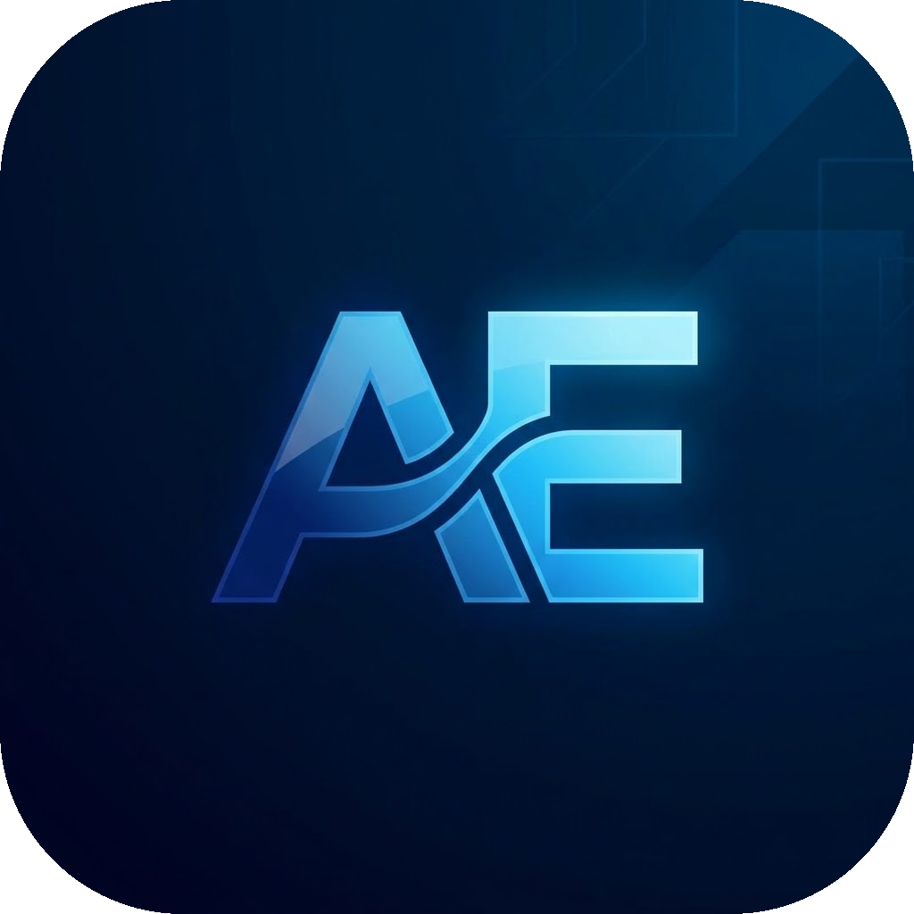

<p align="center">
  
</p>

<h1 align="center">About Evan</h1>

A personal portfolio and profile website highlighting the background, interests, and digital journey of Evan Hendra Mulyadi.

## Live Demo

Experience the live website: [About Evan](https://about-evan.vercel.app/)

## Key Features

- **Responsive Design**: Clean and adaptive layout for desktop, tablet, and mobile devices.
- **Interactive Navigation**: Header navigation bar for desktop and an off-canvas slide-out drawer menu for mobile screens.
- **Profile Showcase**: Dedicated presentation of personal introduction, technological interests, and core disciplines.
- **Lightweight & Fast**: Built as a clean static website with zero build steps or heavy dependencies.

## Tech Stack

- **HTML5** – Semantic markup and document structure
- **CSS3** – Custom responsive styling, flexbox layout, and glassmorphic effects
- **Bootstrap 5** – Responsive grid and utility classes
- **JavaScript (Vanilla)** – Client-side mobile menu toggle interaction

## Getting Started

To run or inspect this project locally:

1. Clone the repository:
   ```bash
   git clone https://github.com/evanhendramulyadi/about-evan.git
   ```

2. Navigate into the project folder:
   ```bash
   cd about-evan
   ```

3. Open `index.html` in any modern web browser, or launch a local server:
   ```bash
   # Using Python 3
   python -m http.server 8000
   ```
   Then open `http://localhost:8000` in your browser.

## Copyright and Ownership

© 2026 Evan Hendra Mulyadi. All Rights Reserved.

This repository is publicly accessible solely for viewing, studying, and reviewing the source code. Public access does not grant permission to copy the entire project, rebrand or rename it, remove attribution, or claim it as your own work. No open-source license or reuse permission is granted without explicit written consent from the owner.
